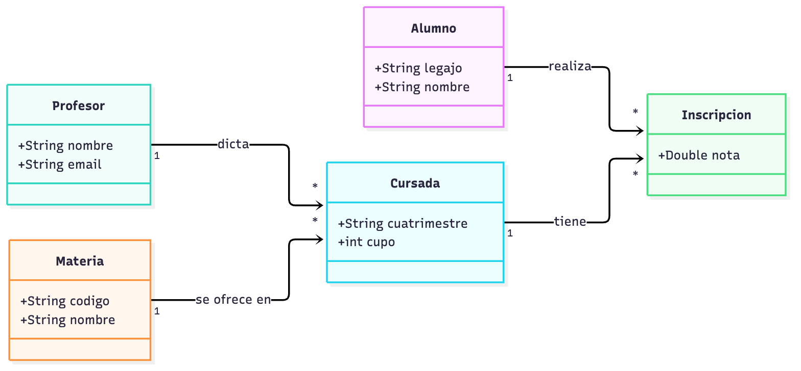

<!-- _class: cover -->
<!-- _paginate: false -->

# Kickoff de MVP

## Del scope al modelo de clases, iterando con IA

**Práctica · DCP**

---

## Dónde estamos

Del TP 0 ya tenés definido:

- ✅ **Nombre** del MVP
- ✅ **Problema** que resuelve
- ✅ **Usuario** y valor
- ✅ **Scope**: qué entra y qué queda afuera

Lo que **falta**: pasar de "qué queremos" a "cómo está armado". Ese es el primer paso de hoy.

> Hoy no escribimos la app. Escribimos el **modelo** de la app.

---

## Objetivo de la práctica

Arrancar el MVP por donde conviene: **entender qué clases lo componen y cómo se relacionan**.

| Sí hacemos hoy | No hacemos hoy |
|---|---|
| Identificar el **modelo base** a partir del scope | Implementar toda la lógica de un saque |
| Dibujar **diagramas** de clases | Elegir frameworks o pantallas |
| Iterar el modelo **con IA** | Aceptar la primera respuesta de la IA |
| Preguntarnos: **¿con esto por ahora alcanza?** | Modelar "por las dudas" cosas fuera del scope |

---

## Ruta del kickoff

1. **Releer el scope** y extraer clases candidatas.
2. Definir **responsabilidades** y datos mínimos de cada clase.
3. Definir las **relaciones** entre clases.
4. **Diagramar** (Mermaid) e **iterar con IA**.
5. Verificar: **¿el modelo cubre todo el scope?**
6. Elegir el **primer flujo** a construir.

> Un modelo chico y claro vale más que uno completo que nadie entiende.

---

<!-- _class: section -->
<!-- _paginate: false -->

# Parte 1

## Del scope al modelo

---

## Paso 1 — Releé el scope con lupa

El scope ya contiene el modelo, solo hay que leerlo con otros ojos:

- Los **sustantivos** son **clases candidatas**.
- Los **verbos** son **operaciones** (crear, consultar, calcular, validar).
- Las **reglas** ("no se puede...", "solo si...") son **restricciones** del modelo.

Ejemplo: *"Alta, baja y modificación de alumnos, profesores, materias y cursadas. Un alumno se inscribe a una cursada."*

`alumno` · `profesor` · `materia` · `cursada` · `inscripción`

> No todo sustantivo es una clase: descartá los que son solo un dato (nombre, email) de otra.

---

## Paso 2 — Responsabilidades y datos mínimos

Para cada clase candidata respondé dos preguntas, en **una línea**:

- ¿Qué **sabe**? (sus datos)
- ¿Qué **hace** o de qué es **responsable**?

| Clase | Sabe | Es responsable de |
|---|---|---|
| Alumno | legajo, nombre | representar a quien cursa |
| Profesor | nombre, email | dictar cursadas |
| Materia | código, nombre | describir qué se enseña |
| Cursada | cuatrimestre, cupo | unir materia + profesor y controlar el cupo |

> Si no podés explicar para qué existe una clase en una línea, probablemente no existe.

---

## Paso 3 — Relaciones entre clases

Una vez que tenés las clases, preguntate cómo se conectan:

- **Tiene / contiene**: una cursada *tiene* inscripciones.
- **Pertenece a**: una cursada *pertenece a* una materia.
- **Usa**: un servicio *usa* un repositorio.

Y para cada relación, la **cardinalidad**: ¿uno a uno? ¿uno a muchos? ¿muchos a muchos?

> Una relación **muchos a muchos** (alumno ↔ cursada) casi siempre esconde una **clase intermedia** (`Inscripcion`) que guarda datos propios, como la nota.

---

<!-- _class: compact -->

## Ejemplo — Scope de una universidad

Un MVP para gestionar una universidad podría tener este scope:

- CRUD de **alumnos**, **profesores** y **materias**
- CRUD de **cursadas** (una materia, dictada por un profesor, en un cuatrimestre)
- **Inscribir** un alumno a una cursada
- Cargar y consultar la **nota** de una inscripción
- Impedir inscribir por encima del **cupo**

**Queda afuera:** pagos, horarios y aulas, correlatividades, roles y usuarios.

Aplicando los pasos 1 a 3 aparecen cinco clases: `Alumno`, `Profesor`, `Materia`, `Cursada` e `Inscripcion`.

---

## Ejemplo — El modelo en un diagrama



> De un vistazo se ve cómo funcionará la app a alto nivel: quién se relaciona con quién y cuántos.

---

<!-- _class: compact -->

## Ejemplo — El diagrama en Mermaid

Escribirlo como texto es más rápido que dibujarlo, y la IA lo entiende y lo genera.

```text
classDiagram
    direction LR
    class Alumno {
        +String legajo
        +String nombre
    }
    class Cursada {
        +int cupo
    }
    Materia "1" --> "*" Cursada : se ofrece en
    Profesor "1" --> "*" Cursada : dicta
    Cursada "1" --> "*" Inscripcion : tiene
    Alumno "1" --> "*" Inscripcion : realiza
```

Pegalo en [mermaid.live](https://mermaid.live) para verlo, o en un `.md` de GitHub (lo renderiza solo).

> Versión completa en `slides/assets/universidad-clases.mmd`.

---

<!-- _class: section -->
<!-- _paginate: false -->

# Parte 2

## Iterar con IA

---

<!-- _class: compact -->

## Paso 4 — Pedile a la IA que proponga el modelo

Es un prompt de **planificación**, no de construcción: pedí modelo y diagrama, no código.

```text
Contexto:
  Estoy armando un MVP de <nombre>: <problema> para <usuario>.
  Kotlin/JVM, consola, sin base de datos externa.
  Este es mi scope:
  <pegá acá el scope in / out del README>

Objetivo:
  Ayudame a PLANIFICAR. No escribas código ni lógica todavía.

Salida esperada:
  - Las clases del modelo base, con datos y responsabilidad (1 línea).
  - Las relaciones y cardinalidades.
  - Un classDiagram en Mermaid.
  - Qué ítems del scope NO quedan cubiertos por este modelo.
```

> Guardá el prompt y la respuesta en `prompt-log/`.

---

## Iterá: desafiá el modelo

La primera respuesta es un borrador. Con cada vuelta, pedile a la IA (y a vos mismo):

- ¿Hay una clase que **sobra** o que no se justifica por el scope?
- ¿Falta algo para cubrir **cada ítem** del scope?
- ¿Quién es **responsable** de validar esta regla (ej. el cupo)?
- ¿Puede ser **más simple**? Proponé una versión con menos clases.
- ¿Qué cambiaría si el scope creciera un poco?

> Cambiá una cosa por vez, volvé a generar el diagrama y comparalo con el anterior.

---

## Paso 5 — ¿Con esto por ahora alcanza?

Recorré el scope ítem por ítem y marcá qué clase lo resuelve:

| Ítem del scope | Clase(s) | ¿Cubierto? |
|---|---|---|
| CRUD de alumnos | `Alumno` | ✅ |
| CRUD de cursadas | `Cursada`, `Materia`, `Profesor` | ✅ |
| Inscribir a un alumno | `Inscripcion` | ✅ |
| Validar el cupo | `Cursada` (¿quién lo controla?) | ❓ |
| Cargar nota | `Inscripcion` | ✅ |

Un ❓ es una **decisión pendiente**: resolvelo con la IA y con el profesor antes de codificar.

> Si cada ítem del scope tiene dueño, el modelo alcanza por ahora.

---

<!-- _class: compact -->

## Errores comunes

- **Modelar todo de golpe**: arrancá con lo mínimo que cubre el scope; el resto se agrega después.
- **Una clase que lo hace todo** (`Manager`, `Sistema`): repartí responsabilidades.
- **Mezclar capas**: el modelo no sabe de pantallas ni de cómo se guarda.
- **Copiar el diagrama de la IA sin entenderlo**: si no podés explicar cada flecha, todavía no es tuyo.
- **Modelar fuera del scope**: si no está en el scope, no entra al modelo.
- **No guardar nada**: prompts y diagrama final al repo desde el primer día.

> Ante la duda, elegí el modelo más simple que resuelve tu problema.

---

## Checklist: tus primeros pasos

- [ ] Releí el **scope** (in / out) de mi `README` y subrayé sustantivos y verbos.
- [ ] Armé la lista de **clases candidatas** y descarté las que son solo un dato.
- [ ] Escribí **una línea de responsabilidad** por clase.
- [ ] Definí las **relaciones** y sus cardinalidades (revisé los muchos a muchos).
- [ ] Le pedí a la IA un **modelo + diagrama Mermaid** con un prompt de planificación.
- [ ] **Iteré** al menos dos veces: desafié el modelo y lo simplifiqué.
- [ ] Recorrí **cada ítem del scope** y verifiqué que alguna clase lo cubre.
- [ ] Guardé el diagrama en el repo (ej. `DISENO.md`) y los prompts en `prompt-log/`.
- [ ] Elegí el **primer flujo** a construir y lo validé con el profesor.

---

## Qué sigue

- Con el modelo cerrado, elegí el **flujo más chico de punta a punta** (por ejemplo, crear un alumno y consultarlo).
- Lo construís **con IA y tests**, sobre el modelo que ya aprobaste.
- Si el modelo cambia, **actualizá el diagrama**: es documentación viva.

El diseño de arquitectura de tu MVP (responsabilidades, historias de usuario y boceto) se trabaja en la práctica de **Diseño inicial del MVP**.

> De la idea al modelo, del modelo al código. Hoy cerraste el primer paso.
